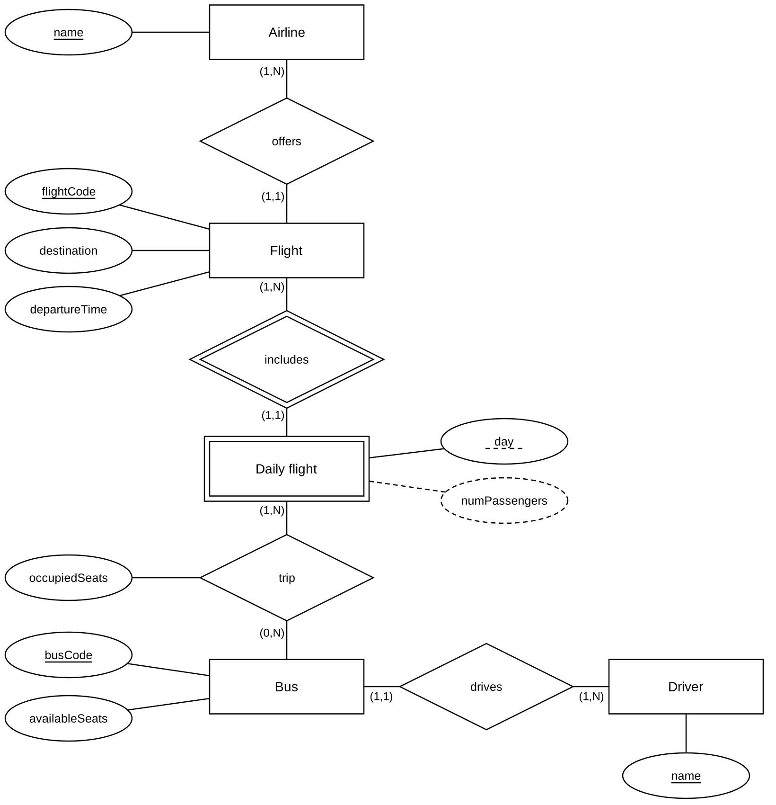

# Paris–Beauvais Shuttle Bus Database

A PostgreSQL database for a shuttle bus service that takes passengers from the
city of Paris to Paris Beauvais airport. I made this project for the
**Databases Lab** (Laboratorio di Basi di Dati) course of the Computer Science
degree at the **University of Udine**. I did it on my own, with the agreement
of the teacher.

The project follows the five classic phases of database design:
requirements analysis, conceptual design, logical design, physical design and
implementation. The full report is in [`docs/report.md`](docs/report.md)
(also available as [PDF](docs/Report.pdf) and [Word](docs/Report.docx)).



## The domain in short

- Flights leave from Beauvais airport. Each flight is offered by one airline
  and is repeated **every day of the week**.
- A *daily flight* is "that flight on that day" (a weak entity).
- One or more **buses** take the passengers of a daily flight to the airport.
  Each of these journeys is a **trip**.
- A bus can make many trips per day, but at most one trip for the same daily
  flight, and on each trip it only carries passengers of one flight.
- The occupied seats of a trip can never be more than the capacity of the bus.

The project text comes from Exercise 1 of an old exam; you can read an English
translation in [`docs/assignment.md`](docs/assignment.md).

## Relational schema

```text
flight      (flightCode, airline, destination, departureTime)
dailyFlight (flightCode, day, numPassengers)
bus         (busCode, driver, availableSeats)
busTrip     (flightCode, day, busCode, occupiedSeats)
```

- `dailyFlight.flightCode` → `flight.flightCode`
- `busTrip.(flightCode, day)` → `dailyFlight.(flightCode, day)`
- `busTrip.busCode` → `bus.busCode`
- Alternative candidate key: `flight(airline, destination, departureTime)`
- `numPassengers` is a **derived attribute** (sum of the occupied seats of the
  trips of that daily flight). I kept it after a redundancy analysis:
  4960 accesses per day with it, 8040 without it.

## Business rules and triggers

| Rule | Description | How it is enforced |
|------|-------------|--------------------|
| R1  | On every trip, `occupiedSeats ≤ availableSeats` of the bus | Trigger `trg_check_capacity` (BEFORE INSERT/UPDATE on `busTrip`) |
| R2  | Every flight has exactly 7 daily flights (Monday–Sunday) | Trigger `trg_generate_daily_flights` (AFTER INSERT on `flight`) |
| R3  | Every daily flight is served by at least one bus | Guaranteed by the population script |
| DR1 | `numPassengers = SUM(occupiedSeats)` of the trips of the daily flight | Trigger `trg_num_passengers` (AFTER INSERT/UPDATE/DELETE on `busTrip`) |

## Operations

The file [`sql/04_queries.sql`](sql/04_queries.sql) contains eight operations.
The queries do not use aggregate functions: "for all" conditions are written
with a double `NOT EXISTS`, and "at least three" and "maximum" are written
without counters.

| Op | What it does | Result on the sample data |
|----|--------------|---------------------------|
| OP-A1 | Insert a new flight (the trigger creates its 7 daily flights) | 7 rows in `dailyFlight` |
| OP-A2 | Insert a new trip (capacity check + derived value update) | `numPassengers` = 28 |
| OP-B1 | Update the occupied seats of a trip | `numPassengers` = 33 |
| OP-B2 | Delete the test flight (cascade on daily flights and trips) | database back to the initial state |
| OP-C1 | Drivers who, on the same day, served flights of **all** the airlines | 26 driver-day pairs |
| OP-C2 | Daily flights served by **at least three** different buses | 89 daily flights out of 350 |
| OP-C3 | Drivers who served **all** the destinations of Air France | 1 driver out of 15 |
| OP-C4 | The daily flight with the **highest** number of passengers | 150 passengers |

## How to run it

**Requirements:** PostgreSQL 12 or newer (the scripts use `MATERIALIZED` CTEs)
and the `psql` client.

From the **root folder** of the repository:

```bash
createdb shuttle
psql -d shuttle -f sql/00_run_all.sql     # schema, triggers, CSV data, trips, checks
psql -d shuttle -f sql/04_queries.sql     # the eight operations
```

`00_run_all.sql` runs the other scripts in the right order. The triggers are
created **before** the data is loaded, otherwise they would not fire. The
`\copy` commands use paths relative to the folder where you start `psql`, so
run it from the root folder.

As an alternative, you can rebuild the populated database from the dump
(created with PostgreSQL 16):

```bash
createdb shuttle
psql -d shuttle -f sql/shuttle_dump.sql
```

The population uses a fixed seed (`setseed(0.42)`), so every run produces
exactly the same 700 trips. At the end of `03_population.sql` there are some
checks (K1–K4) that test the triggers and the generated data: K1, K2 and K3
must return 0 rows.

## Repository structure

```text
.
├── README.md
├── sql/
│   ├── 00_run_all.sql        # runs everything in the right order
│   ├── 01_schema.sql         # Phase 4: enum type, tables, constraints, index
│   ├── 02_triggers.sql       # Phase 5: the three triggers (R2, R1, DR1)
│   ├── 03_population.sql     # Phase 5: generation of the 700 trips + checks
│   ├── 04_queries.sql        # the eight operations
│   └── shuttle_dump.sql      # full dump of the populated database
├── data/
│   ├── flight.csv            # 50 flights (generated with Mockaroo)
│   └── bus.csv               # 15 buses (generated with Mockaroo)
└── docs/
    ├── report.md             # project report (Markdown)
    ├── Report.pdf            # project report (PDF)
    ├── Report.docx           # project report (Word)
    ├── assignment.md         # project text, translated into English
    └── images/               # E/R diagrams (PNG and SVG)
```

## Sample data

- **50 flights** of 5 airlines (Air France, Ryanair, Vueling, easyJet, Wizz Air)
  and **15 buses** were generated with [Mockaroo](https://www.mockaroo.com/).
  I fixed the flight codes afterwards so that the prefix matches the airline
  (AF, FR, VY, U2, W6).
- The **350 daily flights** are created by a trigger.
- The **700 trips** are generated in SQL, so the foreign keys, the primary key
  and the capacity rule are respected by construction: first one trip for every
  daily flight (rule R3), then 350 more random trips.

## Italian names

The original project was written in Italian. If you compare it with the
Italian exam text, these are the names I translated:

| Italian | English |
|---------|---------|
| `offreVolo` (codiceVolo, compagniaAerea, destinazione, oraDecollo) | `flight` (flightCode, airline, destination, departureTime) |
| `voloQuotidiano` (codiceVolo, giorno, numPasseggeri) | `dailyFlight` (flightCode, day, numPassengers) |
| `bus` (codiceBus, autista, postiDisponibili) | `bus` (busCode, driver, availableSeats) |
| `corsaBus` (codiceVolo, giorno, codiceBus, postiOccupati) | `busTrip` (flightCode, day, busCode, occupiedSeats) |
| `giorno_settimana` ('Lunedi' … 'Domenica') | `weekday` ('Monday' … 'Sunday') |
| RD1 (regola di derivazione) | DR1 (derivation rule) |

## Author

**Francesco Saro** – Computer Science student, University of Udine
