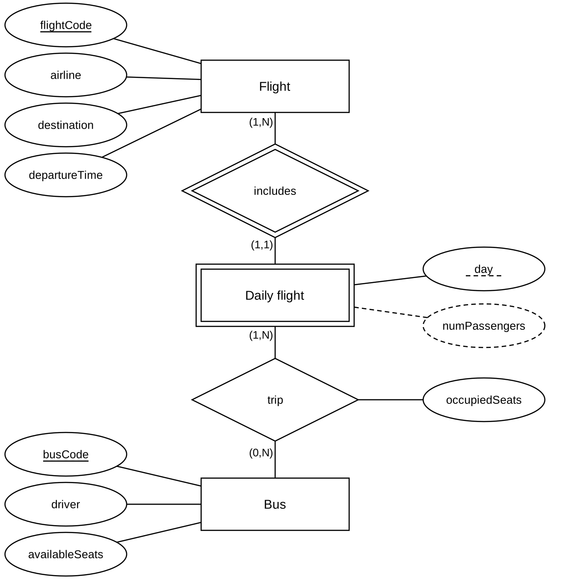

**Francesco Saro – Computer Science, University of Udine**\
**Project done individually, with the agreement of the teacher**

# Project report – Shuttle bus service

## Introduction

The project is about managing a shuttle bus service. The idea is this: flights leave from the airport, and each one is offered by an airline; these flights repeat every day of the week; and to take the passengers of a certain flight to the airport, on a certain day, one or more buses are used.

I followed the five classic phases: first I understood what has to be represented (requirements analysis), then I made a "conceptual" drawing that captures the main ideas, then I turned it into tables, I decided how to store them physically and finally I wrote the actual code.

## Phase 1 – Requirements analysis

In this first phase I clarified the points that could be unclear.

The first point is about the word "day". Since the text talks about "a specific week", I decided that the day means the day of the week (Monday, Tuesday, etc.), not a specific date. The same flight is operated every day, but what the buses really serve is the pair "that flight on that day": this is the thing that makes sense to track.

The second point is the difference between the seats of a bus and the seats that are really used. Every bus has a certain total number of seats (its capacity), while on each single trip only part of those seats is taken by passengers. These are two different things and I kept them separate, with the rule that the occupied seats cannot be more than the capacity of the bus.

I also defined what a "trip" is: it is the journey of a certain bus that takes the passengers of a certain flight to the airport, on a certain day. On one day a bus can make zero, one or more trips, also for flights of different airlines, but never two trips for the same flight; also, on one trip a bus carries passengers of only one flight.

Because of the operations planned for the system, I decided to treat the driver as an entity.

Since the project rules ask for a derived attribute, the most logical choice was the total number of passengers carried, that is the sum of the passengers of all the trips.

**Glossary:**

| **Term**        | **Meaning**                                                                  |
|-----------------|------------------------------------------------------------------------------|
| Airline         | Company that offers one or more flights                                      |
| Flight          | Connection identified by flightCode, with destination, departure time, airline |
| Day             | Day of the week on which the flight is operated                              |
| Daily flight    | Daily instance of a flight (flight + day)                                    |
| Bus (shuttle)   | Vehicle identified by busCode, with capacity and driver                      |
| Driver          | Person who drives a bus                                                      |
| Trip            | Journey of a bus that takes the passengers of a daily flight to the airport  |
| Available seats | Capacity of the bus                                                          |
| Occupied seats  | Seats used on a specific trip                                                |

## Phase 2 – Conceptual design

I drew the conceptual model, only with entities and relationships.

The entities I found are:

- The airline, identified by its name.
- The flight, recognised by its code and described by destination and departure time.
- The daily flight, which is that flight on a given day.
- The bus, recognised by its code and described by its capacity.
- The driver, identified by name.

Conceptual choices:

| **Entity**            | **Attributes**                              | **Identifier**                  |
|-----------------------|---------------------------------------------|---------------------------------|
| Airline               | name                                        | name                            |
| Flight                | flightCode, destination, departureTime      | flightCode                      |
| Daily flight (weak)   | day, numPassengers (derived)                | flightCode (from Flight) + day  |
| Bus                   | busCode, availableSeats                     | busCode                         |
| Driver                | name                                        | name                            |

Driver: I could treat it as a simple property of the bus, but since many of the operations planned for the system reason about drivers as subjects, in this phase I preferred to make it an independent entity. In the logical phase it will be merged back.

Daily flight: modelled as a weak entity, because it can only be identified by saying which flight it belongs to and on which day: "Monday" alone is obviously not enough. I modelled it this way because the trips must be linked to the single day, not to the flight in general.

There are four relationships between these entities, each one with its own cardinality:

- An airline (1,N) offers (1,1) flights: a flight always belongs to exactly one airline, while an airline has at least one flight (I do not store airlines without flights).
- A flight (1,N) includes its (1,1) daily flights: every flight has many of them, and every daily flight belongs to only one flight.
- The trip links daily flight (1,N) and bus (0,N), and it is the heart of the model: a daily flight is served by one or more buses, while a bus can make no trips, one trip or more. I put the number of occupied seats on this relationship, because that value only makes sense for a specific trip.
- The bus (1,1) is driven by a (1,N) driver: every bus has one driver, and a driver can drive more than one bus.

I drew the conceptual model (Figure 1).

*Figure 1 – Conceptual E/R schema (Phase 2).*

Notation choices:

- The attribute day of Daily flight is the discriminator: the full identifier is flightCode (from Flight) + day. This is why I underlined it (with a dashed line).
- numPassengers is drawn with a dashed line because it is the derived attribute, and occupiedSeats is attached to the trip diamond because it is an attribute of the relationship.

### Rules and constraints

- **R1 (integrity constraint):** on every trip, occupiedSeats ≤ availableSeats of the bus that makes it.
- **R2 (constraint):** every Flight has exactly seven Daily flights (one for each day, Mon–Sun). This cannot be expressed with cardinalities only, so it must be stated separately.
- **R3 (constraint):** every Daily flight is served by at least one bus, which means it takes part in at least one trip. The constraint is already expressed by the minimum cardinality 1 on the Daily flight side of the trip relationship, but I mention it here because, like R1 and R2, it cannot be translated into a table constraint: SQL does not allow you to impose a minimum cardinality on a relationship seen from the referenced side. Unlike R1 and R2, I did not write a trigger for it, because it would be the only one that has to block a deletion instead of generating or checking data. The constraint is guaranteed beforehand by the population procedure, described in Phase 5.
- **DR1 (derivation rule):** Daily flight.numPassengers = SUM(occupiedSeats) over the trips of that (flight, day). This is the required derived attribute, and the redundancy analysis in the logical phase is done on it.

## Phase 3 – Logical design

In this phase I turn the drawing into a set of tables. First I restructure the schema, then I translate it.

### Redundancies

The first step was to decide what to do with the number of passengers. Storing it is convenient for whoever reads it, but inconvenient to update; computing it again every time is the opposite.

**Table of volumes**

| **Concept**  | **Type**     | **Volume**          |
|--------------|--------------|---------------------|
| Airline      | Entity       | 5                   |
| Flight       | Entity       | 50                  |
| Daily flight | Entity       | 350 (50 x 7 days)   |
| Bus          | Entity       | 15                  |
| Driver       | Entity       | 15                  |
| Trip         | Relationship | 700                 |
| Offers       | Relationship | 50                  |
| Includes     | Relationship | 350                 |
| Drives       | Relationship | 15                  |

**Table of operations (daily frequencies)**

| **Op** | **Description**                                          | **Type**    | **Frequency** |
|--------|----------------------------------------------------------|-------------|---------------|
| OP1    | Register a new trip with its occupiedSeats               | Interactive | 100/day       |
| OP2    | Update the occupiedSeats of an existing trip             | Interactive | 80/day        |
| OP3    | Read the number of passengers of a daily flight          | Interactive | 300/day       |
| OP4    | Report of the daily flights above a passenger threshold  | Interactive | 10/day        |

**Cost comparison (accesses per day)**

| **Op**     | **With redundancy** | **Without redundancy** |
|------------|---------------------|------------------------|
| OP1        | 2R + 2W = 6 → 600   | 1W = 2 → 200           |
| OP2        | 3R + 2W = 7 → 560   | 1R + 1W = 3 → 240      |
| OP3        | 1R = 1 → 300        | 2R = 2 → 600           |
| OP4        | 350R = 350 → 3500   | 700R = 700 → 7000      |
| **Total**  | **4960**            | **8040**               |

In the count, as usual, a write (W) costs twice as much as a read (R): for example 2R + 2W means 2 + 4 = 6 accesses.

The operations that read the total (OP3, OP4) are very frequent, and with the redundancy they need only one access for each daily flight that is read, while without it they would have to scan all of its trips. In the cost of OP1 and OP2 with redundancy I also counted the reading of the trips of the daily flight involved, two on average, because the trigger that maintains the attribute computes the sum again from the beginning instead of updating it by difference (Phase 5). Even so, the higher update cost is not enough to change the result: 4960 accesses per day against 8040. Conclusion: the derived attribute numPassengers is kept, with the derivation rule DR1 and the triggers that update it. Whether it is convenient depends on the average number of trips per daily flight: the break-even point is around 1.15 trips per flight, so the derived attribute is convenient in all the cases where a daily flight is served by more than one bus, which is the normal situation of the service.

The population described in Phase 5 guarantees that every daily flight is served by at least one bus, with an exact average of two trips per flight: so the average value used in the cost calculation is the same as in the generated data, and it is not an estimate.

### Removing some constructs

The second change is about the two entities that only carry a name: the airline and the driver. Every flight is offered by only one airline and every bus has only one driver; keeping them as separate tables would only add one more join to follow, with no gain, because no operation needs information about the airline or the driver apart from the name. So I "merged" them: the airline into the flight and the driver into the bus, where they become simple attributes. The merge does not lose information thanks to the minimum cardinality 1 on their side of the offers and drives relationships: there are no airlines without flights and no drivers without buses, so every airline and every driver appears in at least one row. The price is that the name is repeated, because an airline offers many flights and a driver can drive more than one bus, but this is acceptable since it is only one attribute. The resulting schema is in Figure 2.

*Figure 2 – Restructured E/R schema: the entities Airline and Driver have been merged into Flight and Bus respectively.*

The translation. By applying the usual rules, I got four tables:

- flight – flight code, airline, destination, departure time. The flight code is what identifies it.
- dailyFlight – flight code, day, number of passengers. Here the row is identified by the pair flight code + day; the flight code refers to the table of flights.
- bus – bus code, driver, available seats. The bus code identifies it.
- busTrip – flight code, day, bus code, occupied seats. Here the combination of the first three is needed to identify the row; this combination automatically captures the rule "a bus makes at most one trip for a given flight-day".

In practice:

flight (<ins>flightCode</ins>, airline, destination, departureTime)\
dailyFlight (<ins>flightCode</ins>, <ins>day</ins>, numPassengers)\
bus (<ins>busCode</ins>, driver, availableSeats)\
busTrip (<ins>flightCode</ins>, <ins>day</ins>, <ins>busCode</ins>, occupiedSeats)

Foreign keys:\
dailyFlight.flightCode → flight.flightCode;\
busTrip.(flightCode, day) → dailyFlight.(flightCode, day);\
busTrip.busCode → bus.busCode.

**Other candidate keys:** apart from the primary keys above, the only alternative candidate key suggested by the domain is on flight: the triple (airline, destination, departureTime) identifies a flight, because the same airline does not offer two different departures to the same destination at the same time. None of the three attributes, alone or in pairs, is enough: an airline has many destinations, a destination is served by more than one airline, and many flights share the same time. I declared it in the schema with a UNIQUE constraint, and I kept flightCode as the primary key because it is a short and stable identifier, already used by the operators, while the triple is long and includes an attribute (the time) that can change when the timetable changes. On the other three tables there are no alternative candidate keys. In bus, driver is not a key because a driver can drive more than one bus – this is exactly the (1,N) cardinality of the drives relationship. In dailyFlight and in busTrip the non-key attributes (numPassengers, occupiedSeats) are numeric values that can be repeated.

The result is exactly the same as the schema in the project text, with the only addition of the number of passengers on the daily flight.

## Phase 4 – Physical design

I chose PostgreSQL as the DBMS. Here I choose how to physically store the data and, above all, which "search shortcuts" (the indexes) to prepare to make the most important queries fast. An index helps to find a row quickly without reading everything.

Some indexes are created on their own, because the system automatically creates one for every key that identifies the rows, including the candidate key on flight declared with UNIQUE. On top of those I added one, on busTrip(busCode). It is the foreign key to the buses, and PostgreSQL does not automatically index foreign keys: without it, every join between buses and trips, which means all the operations that reason about drivers, would need a full scan of the 700 trips, and the same would be true for the integrity checks when a bus is deleted or modified. With the current volumes the gain is small, but busTrip is the table with the most rows and the one that grows fastest when the number of flights and buses increases.

On the other hand, I decided not to create three other indexes that could look useful at first sight. One on flight(airline): selecting by airline appears in two of the four queries, but a separate index would be useless, because the index created automatically by the UNIQUE constraint has airline as its first column and can already serve searches by airline, and also searches by airline and destination like in OP-C3. In any case the table has fifty rows and fits in a single page on disk, and with only five distinct values every search would still return one fifth of the rows: the sequential scan is still the cheapest choice. For the same reason I did not create one on bus(driver): fifteen rows, also in a single page. One on dailyFlight(numPassengers) would only be useful for the report of the busiest flights, but with a few hundred rows the sequential scan costs less than maintaining the index, which would have to be updated at every new trip. The criterion is the same in the three cases: an index is worth it when it saves reads, not when it just moves them, and the three choices should be reconsidered if the volumes grew by an order of magnitude.

On the code side, I wrote the statements that create the four tables, with their data types and the simplest checks (for example: the occupied seats must be strictly positive, because a trip registered without passengers has no meaning in the domain). For the day I used a "fixed choice" type with the seven days of the week, so it is impossible to insert a wrong value. I also defined what happens when data is deleted: if a flight is deleted, its daily flights and their trips disappear too, consistently, while it would not make sense to delete a bus that still has registered trips, because it would leave "orphan" trips.

Two rules, however, cannot be written as a simple check inside a table: the one about capacity, because it connects two different tables (trip and bus), and the one about updating the number of passengers. I moved them to the implementation phase and used triggers for them.

## Phase 5 – Implementation

The last phase is where everything comes to life: I create the database, run the code for the tables, write the automatic mechanisms (the triggers) and finally insert some test data.

A trigger is a statement that the database runs by itself when something happens, for example when a row is inserted or modified. I wrote three of them, one for each rule.

The first one starts when a new flight is created and automatically generates its seven daily flights, one for each day. In this way the rule "every flight repeats for the whole week" is guaranteed by the system, and I only need to insert the flights without worrying about the rows of the daily flights. The trigger guarantees R2 when the flight is inserted. Deleting a single daily flight is not one of the planned operations: a flight is deleted as a whole, and the cascade removes all seven occurrences together.

The second one checks, every time a trip is registered or modified, that the occupied seats are not more than the capacity of the bus: if this happens, the operation is blocked with an error message. This is how I enforce the capacity rule, which I could not express in another way. The check runs on the operations on busTrip. Reducing the capacity of a bus is not one of the operations planned for the system; if it became one, a similar check on bus would be needed, because the rule involves both tables.

The third one keeps the number of passengers up to date: every time a trip is added, modified or deleted, it computes again the sum of the occupied seats of the flight-day involved and writes it back. I preferred to compute the sum again from the beginning instead of adjusting it by adding or subtracting the difference: it costs a bit more, but the value cannot drift over time, because every new trip realigns it with the real sum. However, this choice is not enough if two trips of the same daily flight are registered at the same time: each transaction can compute the sum without seeing the trip of the other one, and one of the two would be lost. With several users it would be necessary to lock the row of dailyFlight before computing the sum again; the project does not consider concurrent access, so this case does not happen here. The trigger keeps the attribute aligned with the trips, but it does not stop someone who writes directly on dailyFlight from changing it: numPassengers must never be modified by hand, because its value is the trigger's job only.

To have enough data to test the queries, I generated a realistic population with Mockaroo, which produces random but realistic data in CSV format. However, not all the tables have to be generated. dailyFlight was left out on purpose: the first trigger fills it by itself, creating the seven daily occurrences for every flight that is inserted. Generating it by hand would have meant clashing with the rows that the trigger creates anyway, and above all it would not have made much sense, since that table exists exactly to be managed automatically. The same is true for the column numPassengers, which is the derived attribute and is computed by the third trigger. So with Mockaroo I only generated the two tables that do not depend on any other table, flight (50 rows) and bus (15 rows), and then I loaded them into the database with the psql \copy command. On the flights I made a correction afterwards: Mockaroo generates each column independently, and the codes were not connected to the airline (an AF code given to a Vueling flight). I realigned the prefixes with the airline, AF for Air France, FR for Ryanair, VY for Vueling, U2 for easyJet, W6 for Wizz Air, consistently with the example in the project text.

For busTrip I chose a different approach. Mockaroo does not know the content of the other tables, so it cannot guarantee any of the three conditions needed here: the flight and bus codes must match rows that really exist, the flight-day-bus combination cannot repeat because it is the key, and the occupied seats must be within the capacity of that specific bus. So I generated the trips directly in SQL, by combining the tables already loaded, so that the references are correct by construction. The generation happens in two steps. The first one assigns a trip to each of the 350 daily flights, choosing a random bus: this guarantees constraint R3, which means that no flight is left without a shuttle. The second one adds 350 more trips picked at random among the combinations not used yet, bringing the total to 700, which is an average of two buses per daily flight, the value that the redundancy analysis of Phase 3 is based on.

One detail that was not obvious needed a correction. In the first version of the script, the sampling of the trips and the calculation of the occupied seats both used the random() function inside the same query, the first one to sort the rows to extract and the second one to decide the load. PostgreSQL reused the same value in both places: since the extraction only keeps the rows with the lowest random value, the occupied seats were always pushed towards the minimum, never above fifteen percent of the capacity. I solved it by isolating the sampling in a subexpression declared MATERIALIZED, which forces the system to compute it separately: in this way the two random draws become independent again. I also fixed the seed of the generator with setseed, so that running the script again produces exactly the same data and anyone can reproduce the population.

The population was also a test of the triggers. After loading the flights, dailyFlight contained exactly seven rows for each flight, so 350 in total: the first trigger works. After inserting the trips, numPassengers had a value on all the rows, and a consistency check that compares each stored value with the sum computed on the spot returned no different rows: the third trigger correctly maintains the derived attribute. The generated loads are realistic: the occupied seats go from 1 to 56 with an average of 24.9, and the fullest trip reaches 100 percent of the capacity of its bus, while the passengers per daily flight reach 150 with an average of 49.8. The second trigger never blocked an insert during the population, and this is the expected behaviour, because the generation picks the occupied seats within the real capacity of the assigned bus; I checked it separately by trying to insert a trip with more passengers than the available seats, and it is rejected every time with the expected error message. Finally, I checked that no daily flight was left without trips, as R3 requires: the check returns zero rows. All these checks are at the end of 03_population.sql, so that anyone who rebuilds the database can repeat them.

## Operations on the database

Eight operations were implemented on the database: two inserts, one update, one delete and four queries. The first four are not only used to populate or correct the data, but they also show how the automatic mechanisms described in the previous phase work. The operations also follow the ones used for the redundancy analysis: registering a trip is OP1 of Phase 3, correcting the occupied seats is OP2, the check reads of numPassengers after each operation match OP3, and the fourth query, which reads the number of passengers of all the daily flights, has the same access profile as OP4.

**Inserts.** Registering a new flight fires the first trigger, which creates the seven daily occurrences by itself. Registering a new trip fires two triggers: the check on the bus capacity and the new calculation of the number of passengers. The test flight gets only one trip, on Tuesday, so on the other six days it temporarily breaks R3: this is acceptable because it is a demo flight, which the final delete removes together with its daily flights, bringing the database back to its initial state.

**Update.** Correcting the occupied seats of a trip that is already registered shows that the derived attribute realigns by itself, without any manual action.

**Delete.** Deleting a flight that is not operated any more shows the cascade: its daily flights and the related trips disappear too, consistently.

**Queries.** The four queries were chosen to cover different constructs and to return, on the generated data, sets that are really selective. The first one finds the drivers who, on the same day, served flights of all the airlines in the system: it is a universal quantification over the airlines, written with a double nested negation, and it selects 26 driver-day pairs out of 105 possible ones. The second one finds the daily flights served by at least three different buses, and it gets the condition "at least three" without counters, by relating three occurrences of the same table linked by increasing bus code: they are 89 daily flights out of 350. The third one finds the drivers who served all the destinations reached by a given airline, and it is again a universal quantification, this time over the destinations: on the generated data only one driver out of fifteen satisfies it. The fourth one finds the busiest daily flight by getting the maximum without aggregate functions, that is by selecting the row for which there is no other row with a higher value, with the advantage that it returns all the rows with the same value in case of a tie. The last two are the most interesting from the point of view of the language; about the third one, it must be noted that if the given airline did not offer any flight, every driver would satisfy the condition, because of the vacuous truth of a quantification over an empty set; this case does not happen here, since Air France serves seven different destinations.

## Conclusions

Starting from a description in words, I arrived at a working database, going through a conceptual drawing, its translation into tables, the choices about indexes and storage, and finally the code. The most interesting choices – turning the driver and the airline from entities into simple properties, deciding to store the number of passengers after weighing costs and benefits, and giving to three triggers the rules that the tables alone could not express – are the ones that show the reasoning behind the project. To these I must add a lesson I learned during the implementation: the correctness of generated data must be checked and not taken for granted. The bug in the first version of the population script did not produce errors or constraint violations – the data was formally valid – but it made the data meaningless, and with it also the test of the capacity constraint. I only noticed it by comparing the distributions I got with the ones I expected.

## Repository contents

| **File**                   | **Content**                                                                                                                                         |
|----------------------------|-----------------------------------------------------------------------------------------------------------------------------------------------------|
| docs/Report.pdf            | This document                                                                                                                                       |
| sql/00_run_all.sql         | Single script: runs 01_schema.sql and 02_triggers.sql, loads the two CSV files and runs 03_population.sql                                          |
| sql/01_schema.sql          | Phase 4. The enumerated type for the days, the four tables with constraints and foreign keys, the candidate key on flight, the secondary index on busTrip(busCode) |
| sql/02_triggers.sql        | Phase 5. The three functions and the three triggers for the rules R2, R1 and DR1                                                                    |
| sql/03_population.sql      | Phase 5. The fixed seed for reproducibility, the generation of the 700 trips in two steps and the tests of the population and of the triggers      |
| sql/04_queries.sql         | The eight operations: two inserts, one update, one delete and four queries                                                                          |
| data/flight.csv            | Data of the 50 flights, generated with Mockaroo                                                                                                     |
| data/bus.csv               | Data of the 15 buses, generated with Mockaroo                                                                                                       |
| sql/shuttle_dump.sql       | Full copy of the populated database, to rebuild it exactly the same without generating anything again                                              |

Order of execution. From the root folder of the project, on an empty database:

    psql -d shuttle -f sql/00_run_all.sql

which runs, in this order, 01_schema.sql, 02_triggers.sql (the triggers must exist before the data arrives, otherwise they do not fire), the loading of the two CSV files and 03_population.sql. Then:

    psql -d shuttle -f sql/04_queries.sql

for the eight operations. As an alternative, sql/shuttle_dump.sql alone rebuilds everything in one go.
